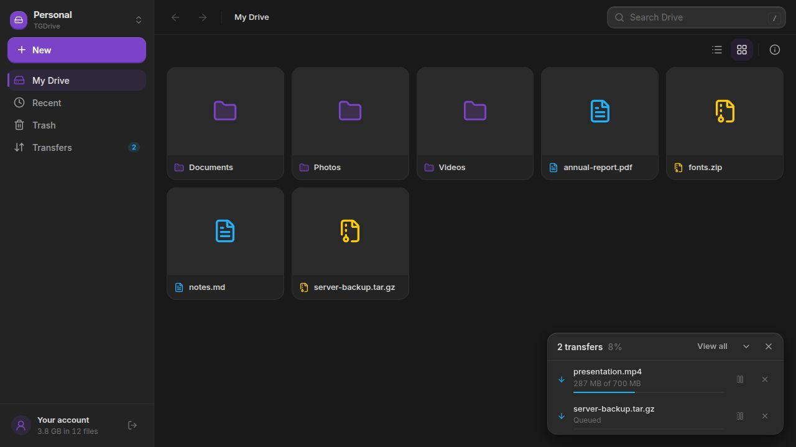

<p align="center"></p>

<h1 align="center">TGDrive</h1>
<p align="center">Your Telegram files, organized like a drive.</p>
<p align="center"><a href="#features">Features</a> · <a href="#installation">Installation</a> · <a href="#getting-started">Getting started</a> · <a href="#questions">Questions</a> · <a href="#contributing">Contributing</a></p>

Browse folders, preview files and keep transfers under control. TGDrive turns
Telegram storage into a file manager you can use with a mouse, a touchscreen
or a gamepad.



## Features

- **Folders that make sense.** Create folders, rename files, and copy or move items to the right place.
- **Find what you need.** Search your vault or browse recent files, with list and grid views.
- **Preview before downloading.** Open supported images, video and audio inside the app.
- **Transfers you can follow.** Track uploads and downloads, pause pending work, and resume it later.
- **Photos where they belong.** Send photos and videos to a TGPhotos vault, choosing its library or an album.
- **Share access to a vault.** Manage members and administrator permissions when your account allows it.

## Installation

| Platform | Download | Architecture |
| --- | --- | --- |
| Linux | [Flatpak](https://tgcloudapps.github.io/tgcloud-flatpak/tgdrive.flatpakref) | x86_64, ARM64 |
| Windows | [Installer](https://github.com/TGCloudApps/tgdrive/releases/latest) | x64, ARM64 |
| Android | [Mobile APK](https://github.com/TGCloudApps/tgdrive/releases/latest) | ARMv7, ARM64, x86, x86_64 |
| Android TV | [TV APK](https://github.com/TGCloudApps/tgdrive/releases/latest) | ARMv7, ARM64, x86, x86_64 |

### Linux

Install [Flatpak](https://flatpak.org/setup/) 1.16 or newer, then run:

```sh
flatpak install --user https://tgcloudapps.github.io/tgcloud-flatpak/tgdrive.flatpakref
flatpak run com.tgcloud.tgdrive
```

Update the app with `flatpak update --user com.tgcloud.tgdrive`.

### Windows

Download the `.exe` installer for your architecture from the release page and
open it. Choose **x64** for Intel/AMD PCs or **ARM64** for Windows on ARM.

### Android and Android TV

Choose the **android-mobile** APK for a phone or tablet, or **android-tv** for a TV.
Open the downloaded file and allow installation from your browser or file manager
when Android asks. The two variants replace each other on the same device.

## Getting started

1. Sign in with your Telegram account and complete two-step verification if enabled.
2. Create a vault, or open an existing TGDrive vault.
3. Choose **New** to create a folder or upload files and folders.
4. Open an item to preview it, or use its menu to rename, move, copy or download it.

A vault is a Telegram channel managed by the app. Use separate vaults to keep
personal files, work documents or shared collections apart.

## Questions

### Can I upload an entire folder?

Yes. Choose the folder upload action from **New**. You can also drag files and
folders into the desktop app when your operating system grants access to them.

### Can I organize files from a read-only vault?

You can browse and download them. Creating folders, uploading and other changes
require the corresponding vault permissions.

### How do I send photos to TGPhotos?

Select the media, choose the send action, then pick a TGPhotos vault and its
library or a destination album. The transfer runs inside TGDrive.

### Can I recover deleted items?

Items in Trash remain recoverable during the retention period. Permanently
deleting an item removes that recovery option.

### Where is my data stored?

Content is stored in Telegram channels on your account. The app also keeps local
metadata, thumbnails and temporary transfer files. Ordinary Telegram channels
are not Secret Chats; keep an independent backup of important files.

## Contributing

Bug reports, translations, documentation and focused pull requests are welcome.
Search [issues](https://github.com/TGCloudApps/tgdrive/issues) and existing PRs before
starting. Discuss new features and large changes first.

To submit a change:

1. Fork this repository and create a descriptive branch from the latest `main`.
2. Address one problem with atomic commits in English, using `type: description`.
3. Check the affected behavior and document any checks you could not run.
4. Open a PR against `main` using the template, with a title such as `fix: restore dialog focus`.
5. Explain the problem and result, attach visual evidence for UI changes, and address review feedback in the same PR.

Read [CONTRIBUTING.md](CONTRIBUTING.md) for the Git workflow, commit conventions,
code and translation rules, required PR details, and the review process.

## Documentation

- [Vault format](FORMAT.md)
